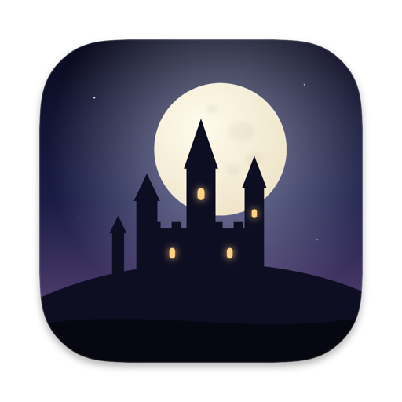
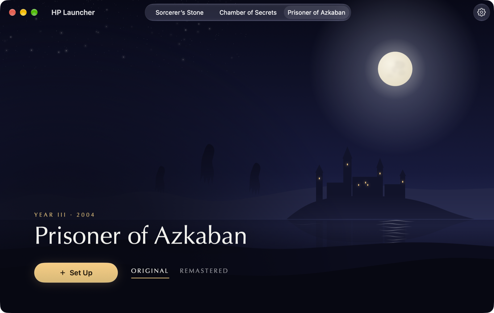

<p align="center"></p>

# HP Launcher

Play the PC versions of *Harry Potter and the Sorcerer's Stone*, *Chamber of Secrets* and *Prisoner of
Azkaban* on a Mac, from your own game files.



## Three ways to play

- **Original**: the Windows game as it shipped, run through [CrossOver](https://www.codeweavers.com/crossover)
  with [dgVoodoo 2](http://dege.freeweb.hu/dgVoodoo2/) for the graphics.
- **Remastered** (beta): the game running natively on the Mac. See below.
- **Custom**: an engine you choose, such as [OpenHP1](https://github.com/SplittyDev/openhp1) for
  *Sorcerer's Stone*, set up for you.

The games aren't included. Choose your installed copy, a ZIP of it or a disc image. The app makes its own
copy and never changes yours.

## The remasters (beta)

The originals are Unreal Engine games built for Windows on x86. The remasters are native arm64 engines
that load the shipped packages and run the games' own UnrealScript, so there's no Wine, no x86
translation and no Direct3D wrapper in the way.

- **Chamber of Secrets**: a fork of [SurrealEngine](https://github.com/dpjudas/SurrealEngine), the
  open-source Unreal Engine 1 reimplementation, extended with the engine classes and natives HP2 adds.
  It renders through Vulkan on MoltenVK and handles gamepads through SDL3. `Game.exe` never runs, so
  copies with SafeDisc work.
- **Prisoner of Azkaban**: HP3 is built on Unreal Engine 2, which SurrealEngine doesn't cover, so it has
  its own engine, written from scratch in C++ with an UnrealScript VM and a Metal renderer. It expects
  the North American release and is keyboard and mouse only for now.

Both are playable start to finish. They're beta, so expect differences from the originals in places.
They're developed separately and ship inside the app; building this repository alone gives you Original
and Custom.

## Requirements

- An Apple silicon Mac with macOS 26
- Your own PC copy of the game
- For Original: CrossOver 26 or later (CrossOver Preview is much faster) and dgVoodoo 2.79.3, which Setup
  links to

## Building

Needs Xcode and [XcodeGen](https://github.com/yonaskolb/XcodeGen).

```sh
tools/test.sh     # unit tests
tools/build.sh    # build/HP Launcher.app
```

The build signs with a Developer ID certificate. Set `DEVELOPMENT_TEAM` in `project.yml` to your own.

## Layout

| Folder | |
| --- | --- |
| `App/Sources/Import` | turning a folder, ZIP or disc image into the app's copy |
| `App/Sources/Original` | running the Windows games under CrossOver |
| `App/Sources/Remastered` | starting the native engines |
| `App/Sources/Custom` | running an engine the player chooses |
| `App/Sources/UI` | the window, setup, settings and the night scenes |

Design notes are in [docs/Design.md](docs/Design.md).

## License

MIT, see [LICENSE](LICENSE). The license covers this code only, not the games or the Remastered engines.

HP Launcher is an independent project, not affiliated with or endorsed by Warner Bros., Electronic Arts or
CodeWeavers. Harry Potter names are trademarks of their owners.
